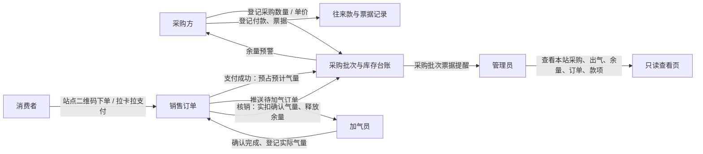
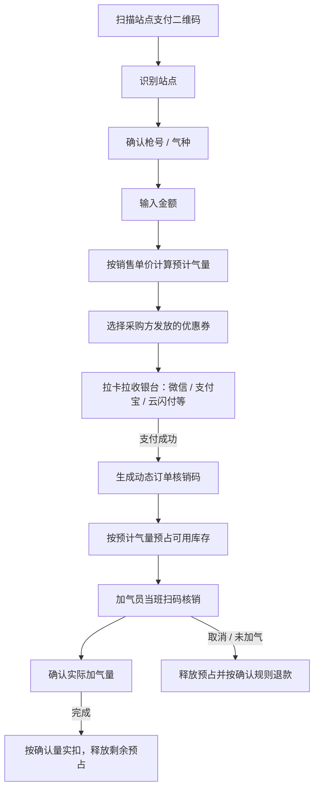
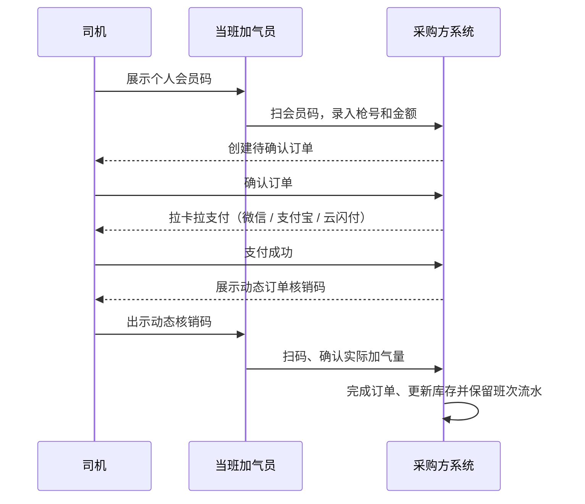
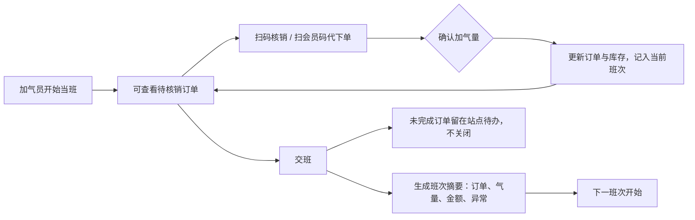
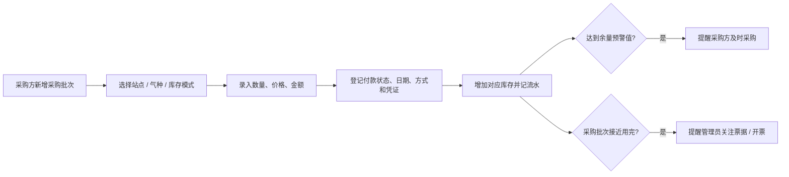
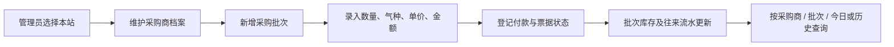
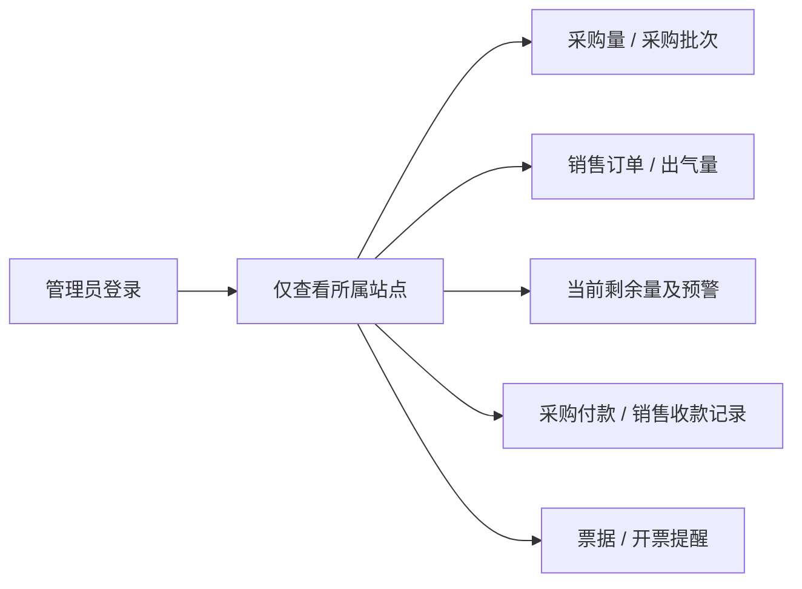

# 加气站批量采购与销售记录系统 · 业务流程

> 配套：`docs/PRD.md`、原型 `design/prototypes/index.html`。本系统服务一个批量采购客户；站点是采购/销售发生地，不是平台化管理客户。

## 1. 采购、销售与库存总览

库存模式由采购方配置：按站点分别管理，或按采购方/气种共享总库存。共享模式仍保留订单的实际加气站归属。

## 2. 消费者主动下单

预计气量只用于订单记录和参考，不代表加气机实测值。退款和实际量差额规则待业务确认。

## 3. 消费者被动下单（加气员代下单）

司机拒绝或订单超时则关闭代下单，不收款、不占用库存。动态码重复使用、已关闭订单码及跨站核销必须拒绝。

## 4. 加气员班次

非当班状态只允许查看历史记录，不允许核销或创建代下单。

## 5. 采购登记与库存预警

## 6. 管理员采购商与批次维护

## 7. 管理员查看

